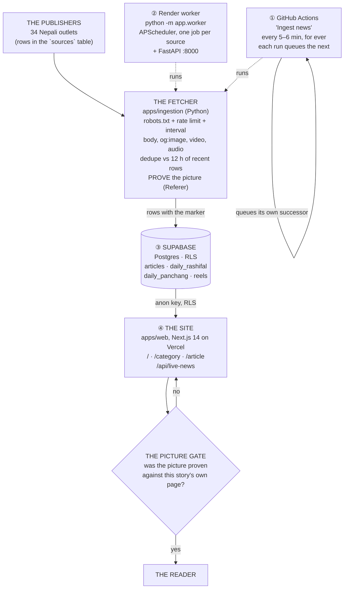

# Architecture

What this system is, what it does with a story, and what keeps it
running without anybody watching it.

---

## The whole system

```
  THE PUBLISHERS — 34 Nepali outlets, each a row in the `sources` table
  10 RSS/Atom feeds · the rest scraped from their listing pages ·
  a few render their pages in JavaScript and carry nothing a plain
  HTTP client can read
  Kantipur · Nagarik · OnlineKhabar · Setopati · MyRepublica · Ratopati · …
        │
        │  HTTPS, one request at a time, politely
        ▼
  ┌───────────────────────────────────────────────────────────────┐
  │  THE FETCHER — apps/ingestion (Python)                        │
  │ 1. robots.txt is read once per host and cached; its Crawl-    │
  │    delay becomes a FLOOR on how often that host may be asked.  │
  │ 2. Per-host rate limit, per-source interval, backoff.          │
  │ 3. The listing page is parsed into cards: headline, url, time,│
  │    and the thumbnail the outlet itself shows.                 │
  │ 4. The article's OWN page is fetched: body, og:image, video,   │
  │    audio.                                                     │
  │ 5. Dedupe against the last 12 hours: content hash, canonical  │
  │    URL, then fuzzy title (threshold 78).                      │
  │ 6. The picture is PROVEN by loading it, with the article's own │
  │    URL as the Referer.                                        │
  │ 7. Four points are lifted verbatim from the body.             │
  │ 8. The row is written, with the marker set only if step 6     │
  │    passed.                                                   │
  └───────────────────────────────────────────────────────────────┘
        │                                    │
        │ run by ①                           │ run by ②
        ▼                                    ▼
  ┌────────────────────────┐        ┌────────────────────────┐
  │ ① GitHub Actions      │        │ ② Render worker        │
  │   "Ingest news"       │        │   python -m app.worker │
  │   every 5–6 min       │        │   APScheduler, one job │
  │   queues the next run │        │   per source, 5–15 min  │
  │   + keep-warm ping    │        │   + FastAPI :8000      │
  └───────────┬────────────┘        └───────────┬────────────┘
              │                                 │
              └───────────────┬─────────────────┘
                              ▼
                   ┌─────────────────────┐
                   │ ③ SUPABASE          │
                   │ Postgres · RLS ·    │
                   │ Auth                │
                   │ articles · sources  │
                   │ daily_panchang      │
                   │ daily_rashifal      │
                   │ reels · admin_users │
                   └──────────┬──────────┘
                              │ anon key (RLS enforced)
                              ▼
                   ┌─────────────────────────────────────┐
                   │ ④ THE SITE — apps/web on Vercel     │
                   │ / (ISR 60 s) · /category · /article │
                   │ /search · /login · /admin          │
                   │ /api/live-news · /feed.xml         │
                   │ /llms.txt · /api/health             │
                   │                                     │
                   │ ► THE PICTURE GATE (see below)      │
                   └──────────────┬──────────────────────┘
                                  ▼
                           THE READER (browser)
```

In Mermaid, for anyone who would rather read it that way:



---

## The two fetchers

| | ① GitHub Actions — "Ingest news" | ② Render — `python -m app.worker` |
|---|---|---|
| Where it runs | github.com, on a shared runner | a Render service (free tier; suspends when idle) |
| What it is | one full pass over all 34 sources, then it exits | a long-lived process with one APScheduler job per source |
| How often | every 5–6 minutes, for ever | each source on its own interval (5–15 min), staggered |
| What starts the next one | the run queues the next run itself | the scheduler, in-process |
| Secrets | `SUPABASE_URL`, `SUPABASE_SERVICE_ROLE_KEY`, `INGESTION_SECRET`, `CRON_SECRET` | the same, on Render |
| If it stops | the cron restarts the chain | the keep-warm ping reports it down; the Actions pass covers the news |
| Which code it runs | whatever is on `main` this minute | whatever it was last **deployed** with |

They overlap on purpose. The Actions pass never sleeps and never goes
stale: it always runs the code that was pushed last. The Render worker
has the tighter per-source interval but only runs the code it was
deployed with, so a change on `main` is not live there until Render
redeploys it.

**When the two disagree, the one on `main` wins.** The Actions pass
writes the picture marker; the site refuses to show a story whose
picture has not been proven. So a stale worker still fills the database
with rows, but the site does not put those rows on screen until they
have been proved.

### The heartbeat

GitHub does not promise that a `schedule:` trigger runs on time. On
2026-10-23 the `ingest.yml` cron — which says `*/5 * * * *` — fired at
01:49, 06:33 and 11:59 UTC: three to five hours apart. So every run
queues the next one (`workflow_dispatch`, which is one of the two events
a `GITHUB_TOKEN` may trigger — no secret of its own is needed, only the
`actions: write` permission the workflow carries for it), and the run
waits before queueing so the gap between passes stays five or six
minutes rather than the ninety seconds a pass actually takes. The cron
stays as the backstop: if the chain is ever broken, the next cron run
starts it again.

### One pass, measured

From the run of 2026-10-23 14:59 UTC:

```
Syncing 34 source(s) (concurrency 5)
25/34 sources ok · 449 fetched · 160 new · 249 deduplicated · 40 rejected
SOURCES_OK=25   REELS_OK=1   PANCHANG_OK=1
```

---

## The picture gate

The rule: **a picture must belong to the story it is shown with.** A
picture that has not been proven against that story's own page is never
shown, and a story with no proven picture is left out of the feed
entirely rather than shown with someone else's photograph.

```
  the article's own page
            │
            ▼
  candidate_images()   junk names rejected (404.jpg, logo, sprite, …)
            │          resizer URLs unwrapped to the real image
            ▼
  the image is LOADED   ranged GET (bytes 0-N), the article's own URL
            │           sent as the Referer, as a browser would
      ┌─────┴──────┐
      │            │
   200 / 206    403 / 404
      │            │
      ▼            ▼
  image_verified_at = now     the marker stays NULL
      │            │
      ▼            ▼
  the site shows it            the site LEAVES THE STORY OUT
```

The marker (`articles.image_verified_at`) is written in the store path,
in the poll's repair pass, in both repair scripts and in the on-demand
search — so every route that stores a picture proves it first.

The Referer is the picture's own page, never a foreign one. The worker
runs from a datacentre in another country, and several Nepali CDNs
refuse an image request that claims to come from nowhere.

### The two repair passes

| | `scripts/refresh_images.py` | `scripts/fix_wrong_images.py` |
|---|---|---|
| Works on | rows whose marker has never been set | rows the marker HAS visited, but whose picture is provably wrong |
| How it finds them | the query | a stored resizer URL (the current code never stores one) or a photograph that is on more than one story |
| What it does | fetches the story's own page, proves a picture, sets the marker | fetches the story's own page, and replaces the picture only with one the page proves |
| Never | invents a picture, or takes one from a feed | — |

Both run from the "Refresh images" workflow: nightly at 03:40 UTC, and
on a button. The first run of 2026-10-23 confirmed 119 pictures and
found 22 suspects already right.

---

## The database

One Postgres, in Supabase. The web app reads it with the **anon key**,
so Row Level Security is the real boundary for every browser-facing
request; only the ingestion service and the admin panel hold the
service-role key.

| Table | What it holds |
|---|---|
| `articles` | every story: headline, excerpt, slug, body (only where the outlet allows it), the picture columns, `image_verified_at`, `duplicate_of`, `status`, `published_at`, `ingested_at`, the source snapshot |
| `sources` | the 34 outlets: their feed or listing URL, their poll interval, `allowed`, `enabled`, their politeness settings, their selectors |
| `categories` | the section taxonomy the navigation, the routing and the sitemap are built from |
| `article_sources` | every outlet that carried a story, so "also reported by N outlets" can be shown |
| `source_sync_logs`, `source_errors` | what each pass fetched, and what failed |
| `daily_panchang` | the almanac per day, fetched from hamropatro.com: the Bikram Sambat date, the tithi, the nakshatra, the sun's times, and the शुभ / अशुभ windows |
| `daily_rashifal` | the twelve horoscopes per day, fetched from the same publisher, one row per sign |
| `reels`, `reel_likes`, `reels_source_health` | the video clips, the reader's likes, and which provider is switched on |
| `article_views`, `analytics_events` | the raw rows behind the view counter, and the reader events (view, search, share, click) |
| `scrape_requests` | the audit trail of on-demand re-fetches, and the rate-limit source |
| `admin_users`, `admin_sessions`, `admin_login_attempts` | the admin sign-in, its revocable sessions, and the durable brute-force counters |
| `user_roles` | the other sign-in path: which role a Supabase Auth user has |

Rows are pruned 48 hours after publication by
`prune_expired_articles()` — breaking and featured rows are never pruned
— and can be fetched again on demand if somebody searches for a story
that has aged out. There is no soft delete: a row leaves by being
deleted, and the delete cascades to everything that referenced it.

README.md has the schema, the columns that decide what a reader sees,
and the read path the site uses.

---

## The site

`apps/web`, Next.js 14 App Router, on Vercel.

| Route | What it shows |
|---|---|
| `/` | the home feed (ISR, revalidated every 60 s) |
| `/category/[slug]` | a category, including `/category/reels` and `/category/rashifal` |
| `/article/[slug]` | one story, with the outlet credited and a link back to it |
| `/search` | Postgres full-text and trigram search, so Devanagari queries match |
| `/login`, `/admin` | the operator's sign-in and the dashboard |
| `/api/live-news` | what the browser polls to fill and extend the feed, and to pick up new stories |
| `/api/search`, `/api/articles/view`, `/api/ai-search` | the search and view-count surface |
| `/feed.xml`, `/llms.txt`, `/api/health` | the syndication and health surface |

The picture gate is applied **on the server before the list is sliced**,
and the browser applies the same rule to what it fetches — so the first
paint and the first poll agree, and no card is ever taken away under the
reader.

---

## What runs on its own

| Thing | How often | What it is |
|---|---|---|
| The heartbeat | every 5–6 min | the Actions pass, which queues its own successor |
| The cron backstop | when GitHub gets round to it (hours) | the same workflow, started by the schedule |
| The keep-warm ping | with the heartbeat | a courtesy GET to the Render worker, so its free instance does not suspend |
| "Daily almanac" | 19:15 UTC | the day's panchang and the twelve horoscopes |
| "Refresh images" | 03:40 UTC | the two picture repair passes |
| CI | on every push | lint, type-check, build, and the 590 + 155 tests |

---

## What is real, and what is not

| Piece | Status |
|---|---|
| The database, RLS, triggers, search vector | Complete and running |
| The ingestion pipeline (fetch → dedupe → categorise → store → log) | Complete, for RSS and listing adapters |
| Duplicate detection (hash, canonical URL, fuzzy title) | Complete |
| The scheduler, with per-source intervals and backoff | Complete, on the Render worker and in the Actions pass |
| The picture proofing and both repair passes | Complete and running |
| Reels (Wikimedia, Pexels, Pixabay, YouTube) | Complete; the keyless provider works alone, the keyed ones need their secrets |
| The almanac and the horoscopes, with the week ahead | Complete; the day ahead is walked every six hours |
| The site, the admin panel, the search | Complete |
| The picture for publishers that render in JavaScript | **Not proven** — 278 rows are hidden rather than shown wrongly, because their pages carry nothing to prove a picture with |
| The `categories`/`tags` taxonomy | Present, but the categoriser is keyword-based |

---

## Honest limitations

- **Two fetchers can both run.** That is deliberate, but it means two
  sets of requests to every publisher. The Actions pass and the Render
  worker must never both be deployed with the same aggressive schedule.
- **The Render worker runs old code until it is redeployed.** Its
  `/api/health` reports `deployed_commit`; if that commit is not the tip
  of `main`, the worker is behind.
- **A laptop can be part of this picture by accident.** A copy of the
  ingestion API left running on a laptop polls every publisher every 90
  seconds with whatever code it was started with. The site does not
  depend on it; the publishers do.
- **The picture gate hides stories.** A story whose picture cannot be
  proven is not shown at all. That is the operator's rule, and it costs
  the feed some stories — 278 of them at the moment this was written.
